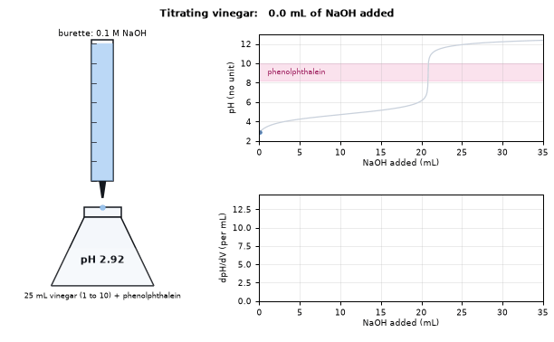
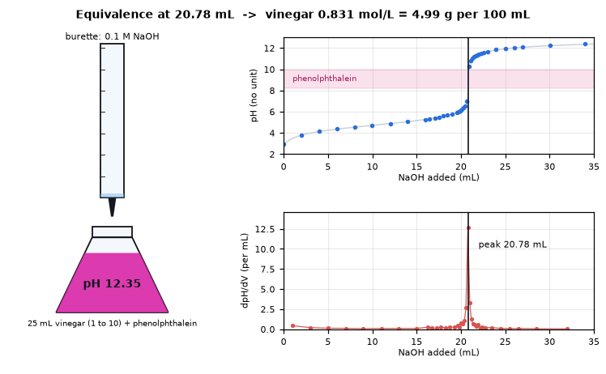
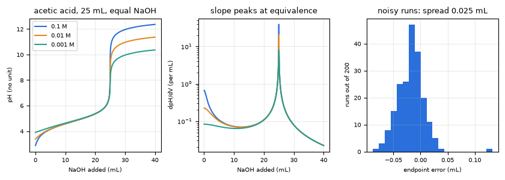
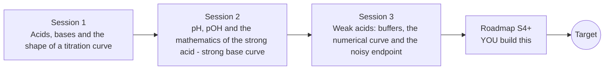

# openphtitration

[](https://github.com/KrunalPanchal1995/openphtitration/actions/workflows/ci.yml)   [](https://colab.research.google.com/github/KrunalPanchal1995/openphtitration/blob/main/sessions/session-01/lesson.ipynb) [](https://krunalpanchal1995.github.io/openphtitration/)

**Find an unknown acid concentration from a titration curve, in three sessions.**

openphtitration teaches how a pH curve reveals the concentration of an acid, from the pH scale to a numerical weak-acid titration solved with your own root finder, using only Python and a browser.

- **Start from zero.** Session 1 needs only the idea of a ratio and a logarithm; every symbol is explained.
- **See the jump.** Every session ships a slider app: change a concentration and watch the curve and flask colour respond.
- **Know you got it right.** Checkpoints compare your numbers with hand calculations and with analytic limits.
- **Build the missing half.** The repo stops at Session 3 on purpose; the roadmap shows the path to the Target.

[Target](#the-target) · [Who is this for](#who-is-this-for) · [Quick start](#quick-start) · [Sessions](#sessions) · [Roadmap](#roadmap) · [Contribute](#contribute) · [Explainer PDF](docs/explainer.pdf)

> **This repo is incomplete on purpose.** Sessions 1 to 3 are here and fully working. The finished Target below is a preview of what the community can build next. We show you the path, not the code. Sessions 4 and up are yours.

## The Target

An animated burette drips 0.1 mol/L base into a flask of diluted vinegar. The flask turns pink as the pH passes the phenolphthalein range, the measured pH points (with realistic noise) appear one by one, and below them the slope of the curve spikes at the equivalence point. The final frame reads the peak and prints the vinegar concentration, about 0.83 mol/L or 5 g per 100 mL. Your goal over the coming sessions: build the numerical engine and the analysis behind that animation.



*Target: a burette titration of vinegar with a live pH curve and a derivative peak at the equivalence point*



*Target, final frame: the derivative peak gives the equivalence volume and the vinegar concentration*



*Target analysis: more dilute acids give a smaller jump; 200 noisy runs show how well the peak is located*

Try it live:

- [Math Visual Studio: root finding (Atlas S29)](https://krunalpanchal1995.github.io/studio/#atlas?ch=S29&ex=1)
- [Math Visual Studio: numerical differentiation (Atlas S30)](https://krunalpanchal1995.github.io/studio/#atlas?ch=S30&ex=1)

How the Target was made is shown only as a path in [promo/roadmap.md](promo/roadmap.md).

## Who is this for
**secondary school to diploma / undergraduate (levels 3-5).** Topic area: Chemistry and Materials Science.

Prerequisites:

- Basic arithmetic with ratios and powers of 10; the idea of a logarithm is explained in Session 1.
- Python 3.10 or newer; if `python --version` works, you are ready. PRIMER.md explains the rest.
- No chemistry laboratory experience is needed. This is a computer simulation; real acids and bases must only be handled with supervision.

New to Python? Read [PRIMER.md](PRIMER.md) first (10 minutes).

## Quick start

No installation knowledge needed. You need [Git](https://git-scm.com/downloads) and [Python 3.10+](https://www.python.org/downloads/) (Windows: tick "Add Python to PATH"). On Mac and Linux type `python3` wherever this page says `python`.

```bash
git clone https://github.com/KrunalPanchal1995/openphtitration.git
cd openphtitration
python start.py 1
```

`start.py` creates a private environment, installs what is needed and runs Session 1 with its checkpoint. Next: `python start.py 2`, `python start.py 3`, or `python start.py test` to check everything. Only a checkpoint: `python start.py check 1`.

Four lines turn the idea of Session 1 into a result (they work as they are): Save it as `try.py` and run it with `python start.py run try.py` (this uses the private environment, where NumPy is installed):

```python
import numpy as np
x = (0.1 * 25 - 0.1 * 10) / (25 + 10)      # leftover acid after 10 mL of base, mol/L
print(round(-np.log10(x), 3))              # -> 1.368  the pH of the flask
print(0.1 * 25 / 0.1, 'mL of base reach the equivalence point')   # -> 25.0
```

Every session also opens in your browser with sliders (no install): [live apps](https://krunalpanchal1995.github.io/openphtitration/). Or use the Colab badge above for the notebook.

## Sessions

| # | Session | Model level | Time | Live app |
|---|---|---|---|---|
| 1 | [Acids, bases and the shape of a titration curve](sessions/session-01/README.md) | Level 1: conceptual interactive model | 60 min | [open](https://krunalpanchal1995.github.io/openphtitration/session-01/) |
| 2 | [pH, pOH and the mathematics of the strong acid - strong base curve](sessions/session-02/README.md) | Level 2: mathematical engineering model | 75 min | [open](https://krunalpanchal1995.github.io/openphtitration/session-02/) |
| 3 | [Weak acids: buffers, the numerical curve and the noisy endpoint](sessions/session-03/README.md) | Level 3: simulation and validation | 90 min | [open](https://krunalpanchal1995.github.io/openphtitration/session-03/) |

Each session follows the same six steps: A real-world problem, B concept and theory, C visual explanation, D interactive simulation, E worked example and experiment, F assessment and design challenge. Each ends with `checkpoint.py`, which prints `PASS` or `FAIL` against reference numbers. Session 3 also contains the real-world mini-project: **Find the acid in a bottle of vinegar**.

## Architecture



| Folder or file | What is inside |
|---|---|
| `sessions/` | three sessions: README (A-F), `lesson.py`, notebook, live app, exercises, activity sheet, checkpoint |
| `promo/` | the Target: media, live links, and the roadmap (path only) |
| `docs/` | `explainer.tex` and the built `explainer.pdf` |
| `tests/` | runs every lesson and checkpoint headless |
| `start.py` | one command to set up and run anything |
| `QUALITY.md`, `RUBRIC.md` | the quality checklist and the scoring rubric |
| `.github/` | CI, PDF build, Pages deploy, issue and PR templates |

## Roadmap

| Milestone | What you will build | Difficulty |
|---|---|---|
| Session 4: Fit the whole curve | A fitting routine that adjusts the concentration (and pKa) to minimise the squared pH residuals. | intermediate |
| Session 5: Identify an unknown acid by its pKa | A function that estimates pKa and the concentration from one run and names the closest acid in a small table. | intermediate |
| Session 6: A diprotic acid with two jumps | A charge-balance solver for a diprotic acid titrated with a strong base. | advanced |
| Session 7: When 25 C is not enough | A solver whose Kw is a parameter, with a neutral-pH function. | advanced |
| Session 8: Animate the titration | A GIF of at most 60 frames and 3 MB in which the burette empties, the flask colour changes and the derivative peak is marked. | advanced |

Full detail with a checkpoint per milestone: [promo/roadmap.md](promo/roadmap.md).

## Contribute
New to GitHub? Read [CONTRIBUTING.md](CONTRIBUTING.md); it starts from zero. Pick an issue labelled `good first issue`. Translations into Hindi, Telugu, Tamil and Malayalam are welcome.

<details>
<summary>Development</summary>

```bash
python start.py test        # runs every lesson and checkpoint
```
Lessons use `# %%` cell markers so they open as notebooks in VS Code. See [QUALITY.md](QUALITY.md) for the standard every session meets.
</details>

## License
MIT. See [LICENSE](LICENSE). Media in `promo/media` is (c) Krunal Panchal, CC BY 4.0.

## Acknowledgments
Part of the [PAN IIT OSS](https://hellofoss.tech-iitb.org/projects) open-source teaching collection, modelled on the structure of [openspline](https://github.com/openspline/openspline). Built on ideas from the Math Visual Studio at https://krunalpanchal1995.github.io/studio/.
