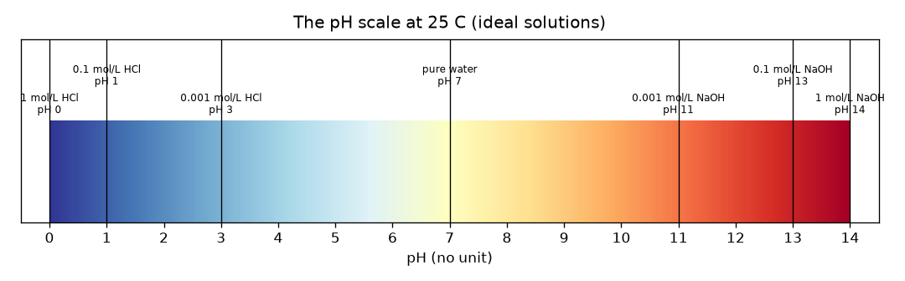
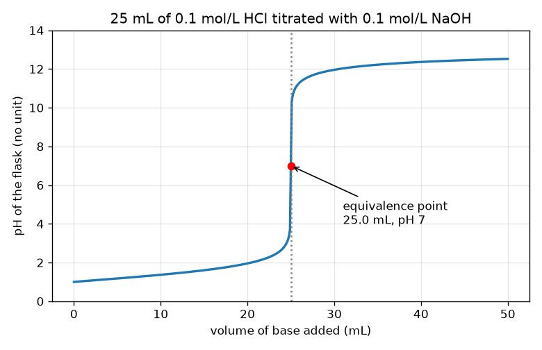

# Session 1: Acids, bases and the shape of a titration curve

*Level 1 (conceptual interactive model) · about 60 minutes · openphtitration*

> This is a simplified educational model. It is not a validated design tool and must not be used for real structures, electrical installations, vehicles, industrial processes or medical decisions.

**Prerequisites**

- Ratios and powers of 10.
- You have read PRIMER.md and run `python start.py 1` once.

**Learning objectives.** After this session you can:

- Say what pH measures and read the scale from 0 to 14, with pH 7 neutral.
- Compute the pH of a strong acid or strong base from its concentration.
- Explain why adding base to acid raises the pH slowly and then suddenly.
- Find the equivalence point on a titration curve and from the mole balance.

## A. Real-world problem
A lab has a bottle of acid and needs to know how strong it is. They cannot taste it and the label is gone. So they add a base of known strength from a glass tube (a burette), a little at a time, and watch the liquid in the flask. At first almost nothing seems to happen; then, with one more drop, everything changes. How does that sudden change reveal the strength of the acid? This is general education about a simulation: real acids and bases must only be handled with a teacher, goggles and the right equipment.

## B. Concept and theory
Water always contains a few hydrogen ions (H+). An acid adds more of them, a base removes them. The pH is the number that measures this: pH = -log10[H+], where [H+] is the concentration of hydrogen ions in mol/L. Because of the logarithm, a drop of 1 in pH means ten times more H+. A solution with pH below 7 is acidic, 7 is neutral (pure water at 25 C) and above 7 is basic. A strong acid such as hydrochloric acid (HCl) splits completely, so 0.1 mol/L HCl has [H+] = 0.1 and pH 1. In a titration we add base of known concentration Cb from a burette to Va mL of acid of concentration Ca. Acid and base cancel mole for mole. While acid is left over, the pH is low. Exactly when the moles of base added equal the moles of acid, we are at the equivalence point; just past it, base is left over and the pH is high. The leftover is divided by the total volume, so the pH changes slowly while there is plenty of acid and very fast when the leftover is tiny.

| Symbol | Meaning | Unit |
|---|---|---|
| pH | measure of acidity, -log10[H+] | no unit |
| [H+] | concentration of hydrogen ions | mol/L |
| Ca, Va | concentration and volume of the acid in the flask | mol/L, mL |
| Cb, Vb | concentration and volume of the base added | mol/L, mL |
| Ve | equivalence volume: base needed to cancel all the acid | mL |

**Assumptions**

- Strong acid and strong base: both split completely.
- 25 C, so pure water has pH 7.
- Ideal solutions: the simple concentrations are used (real strong solutions of 1 mol/L or more deviate).
- The volumes simply add.

$$ \mathrm{pH}=-\log_{10}[\mathrm{H}^+] $$

$$ x=\frac{C_aV_a-C_bV_b}{V_a+V_b}\quad(\text{leftover acid if }x>0,\ \text{leftover base if }x<0) $$

$$ C_aV_a=C_bV_e\quad\Rightarrow\quad V_e=\frac{C_aV_a}{C_b} $$

## C. Visual explanation
The first figure is the pH scale as a colour bar from 0 to 14 with familiar solutions placed on it: 1 mol/L HCl at 0, pure water at 7, 1 mol/L NaOH at 14. The second figure is the titration curve of 25 mL of 0.1 mol/L HCl with 0.1 mol/L NaOH. The curve climbs slowly from pH 1 to pH 3.7 over the first 24.9 mL, then leaps from 3.7 to 10.3 in the next 0.2 mL, and flattens again near pH 12. The red dot at 25 mL, pH 7 is the equivalence point.

*The pH scale from 0 to 14 with strong acid and base solutions placed on it.*

*25 mL of 0.1 mol/L HCl titrated with 0.1 mol/L NaOH: slow rise, sudden jump, flattening; the red dot is the equivalence point.*

## D. Interactive simulation
Run the lesson (`python start.py 1`), then open the live app: [Session 1: add base to acid](https://krunalpanchal1995.github.io/openphtitration/session-01/) (or `app.html` in this folder). Drag the base volume and watch the burette level fall and the flask colour change from red (acid) through green (neutral) to violet (base). Then open the curve view and see where the steep jump sits. Change the acid and base concentrations and see how the jump moves.

**Challenge.** Neutralise the acid exactly: set the base volume and concentrations so that the moles of base equal the moles of acid (Cb x Vb = Ca x 25 within 0.01 mmol) and the flask shows pH 7.

## E. Worked example and experiment
**Problem.** 25 mL of 0.1 mol/L HCl is titrated with 0.1 mol/L NaOH. Find the pH after 10 mL of base, and the equivalence volume.

1. Moles of acid at the start: 0.1 mol/L x 25 mL = 2.5 mmol.
2. Moles of base added: 0.1 mol/L x 10 mL = 1.0 mmol. They cancel one for one, so 2.5 - 1.0 = 1.5 mmol of acid is left.
3. Total volume = 25 + 10 = 35 mL, so [H+] = 1.5 / 35 = 0.04286 mol/L.
4. pH = -log10(0.04286) = 1.368.
5. Equivalence: Ca Va = Cb Ve gives Ve = 0.1 x 25 / 0.1 = 25 mL, where only water and salt are left and pH = 7.

**Answer.** After 10 mL the pH is 1.368; the equivalence volume is 25 mL (pH 7).

**Experiment.** In a school laboratory (with supervision) a teacher would titrate dilute hydrochloric acid with dilute sodium hydroxide using a pH meter and compare it with this curve. The real curve is slightly smoother at the corner and the pH at 0 mL is not exactly 1 because real solutions are not ideal and the meter has about 0.02 to 0.05 pH of uncertainty. The model is a clean idealisation; the lab adds measurement noise and non-ideal behaviour.

## F. Assessment and design challenge
**Question type A: Conceptual.** Why does the pH hardly change for the first 20 mL of base and then jump within a fraction of a millilitre near 25 mL?

Hint

Think about how many moles of acid are still left, and what happens when you divide a tiny leftover by the volume.

Step-by-step solution

The pH depends on the leftover H+ concentration on a logarithmic scale. Early on there is a lot of acid left, so removing a little more only changes the concentration by a small factor (pH 1.0 to 1.95 in 20 mL). Near the equivalence point the leftover is tiny, so a further 0.1 mL changes it by a large factor, and past it the leftover becomes base. Only a few drops take the flask from a concentration of 1e-4 mol/L of H+ to 1e-4 mol/L of OH-, which is a change of 6.6 pH units.

**Question type B: Numerical.** What is the pH after 20 mL of 0.1 mol/L NaOH has been added to 25 mL of 0.1 mol/L HCl? Show the units and check that the answer is sensible.

Hint

Count millimoles of acid and base, subtract, and divide by the total volume.

Step-by-step solution

Acid 2.5 mmol, base 2.0 mmol, left 0.5 mmol in 45 mL, so [H+] = 0.01111 mol/L and pH = 1.954. Sanity check: it is above the starting pH 1 (some acid is gone) but still acidic and well below 7, as expected before the equivalence point.

**Question type C: Graph and simulation interpretation.** On the titration curve, how much does the pH change between 24.9 mL and 25.1 mL, and what does that tell you about reading the burette near the end?

Hint

Read the pH at 24.9 mL and at 25.1 mL from the output of lesson.py.

Step-by-step solution

The pH goes from 3.698 to 10.300, a change of 6.6 units in only 0.2 mL. Near the equivalence point a burette reading error of 0.05 mL changes the pH by several units, so the equivalence volume can be located very precisely, but one must add base drop by drop near the end.

**Question type D: Design and optimisation challenge.** Design: you have 25 mL of 0.1 mol/L acid and a choice of 0.1 mol/L or 0.2 mol/L base. Which do you choose and why? State the equivalence volume for each and the trade-off.

Hint

Compute Ve for each, and compare a burette reading error of 0.05 mL with each volume.

Step-by-step solution

Ve = 25 mL with 0.1 mol/L base and 12.5 mL with 0.2 mol/L base. A reading error of 0.05 mL is 0.2 percent of 25 mL but 0.4 percent of 12.5 mL, so the weaker base gives the smaller relative error, but it needs a bigger burette volume and a longer titration. The stronger base saves time and liquid but doubles the relative reading error. Assumption: the same reading error in both cases.

Score yourself with [RUBRIC.md](../../RUBRIC.md). Print the [activity sheet](activity_sheet.md) to work on paper.

## Common misconceptions
| Common misconception | What is actually true |
|---|---|
| A solution of pH 7 has no ions. | Pure water at 25 C has 1e-7 mol/L of H+ and the same of OH-; neutral means equal amounts, not none. |
| pH 2 is just a little more acidic than pH 3. | It is ten times more H+. The scale is logarithmic. |
| The pH rises steadily as you add base. | It rises slowly, then jumps at the equivalence point, then flattens again. |
| The equivalence point is wherever the indicator changes colour. | The equivalence point is where moles of base equal moles of acid; the indicator colour change (the endpoint) should be chosen to be as close to it as possible. |

## Glossary
- **pH**: measure of acidity: minus the base-10 logarithm of the hydrogen-ion concentration
- **acid**: a substance that raises the hydrogen-ion concentration of water
- **base**: a substance that lowers it (it adds hydroxide ions)
- **titration**: adding one solution of known concentration to another until they exactly cancel
- **burette**: a graduated glass tube with a tap, used to add liquid in small measured amounts
- **equivalence point**: the moment when moles of base added equal the moles of acid originally present

## Finish
1. Do the three coding tasks in [exercises.md](exercises.md).
2. Run `python start.py 1` again after your changes. It ends with the checkpoint; when it prints `PASS`, you are done. (Checkpoint only: `python start.py check 1`.)

Next: [Session 2](../session-02/README.md)
