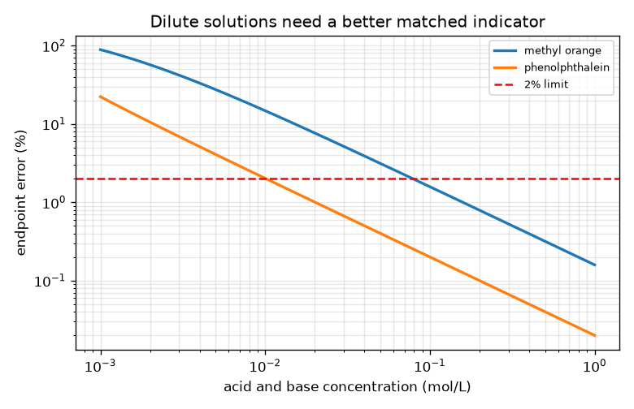
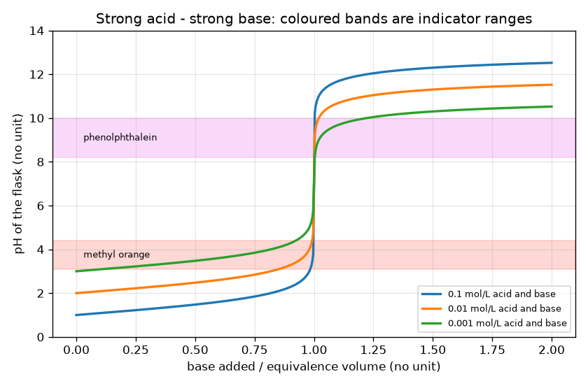

# Session 2: pH, pOH and the mathematics of the strong acid - strong base curve

*Level 2 (mathematical engineering model) · about 75 minutes · openphtitration*

> This is a simplified educational model. It is not a validated design tool and must not be used for real structures, electrical installations, vehicles, industrial processes or medical decisions.

**Prerequisites**

- Session 1: pH and the titration curve.
- Logarithms: log10(10^n) = n.

**Learning objectives.** After this session you can:

- Use pH = -log10[H+], pOH = -log10[OH-] and pH + pOH = 14 at 25 C.
- Use the mole balance Ca Va = Cb Vb at equivalence to find an unknown concentration.
- Compute the pH before, at and after equivalence in code and check it by hand.
- Choose an indicator whose colour range sits on the steep part, and dilute with C1 V1 = C2 V2.

## A. Real-world problem
A water-treatment student must find the strength of an acid sample and has two dyes: methyl orange and phenolphthalein. A wrong dye changes colour too early or too late and the answer is off. How do we compute the whole curve, turn the burette reading into a concentration, and pick a dye that is right for the job? As before, real chemicals need supervision: this is a simulation and general education.

## B. Concept and theory
Water always keeps [H+][OH-] = Kw = 1e-14 (mol/L)^2 at 25 C. Taking -log10 of both sides gives pH + pOH = 14. During a titration, the net leftover x = (Ca Va - Cb Vb)/(Va + Vb) is positive (acid left), zero (equivalence) or negative (base left). Including water, x = [H+] - Kw/[H+], so [H+] = (x + sqrt(x^2 + 4 Kw))/2. This one formula gives pH 1 at the start of 0.1 mol/L HCl, exactly 7 at equivalence (x = 0) and a high pH after it. At equivalence the moles balance, Ca Va = Cb Ve, so one burette reading gives the concentration: Ca = Cb Ve / Va. An indicator is a dye that changes colour over a short pH range. The colour changes at the volume where the flask pH is in that range, so we ask how far that volume is from Ve. Methyl orange changes at about pH 3.1 to 4.4 and phenolphthalein at about 8.2 to 10 (approximate, well-known ranges). Finally, diluting does not change the moles of dissolved acid: C1 V1 = C2 V2.

| Symbol | Meaning | Unit |
|---|---|---|
| pH, pOH | -log10[H+], -log10[OH-] | no unit |
| Kw | ion product of water, 1e-14 at 25 C | (mol/L)^2 |
| x | net leftover acid (+) or base (-) | mol/L |
| Ca, Va | acid concentration and volume | mol/L, mL |
| Cb, Vb, Ve | base concentration, volume added, equivalence volume | mol/L, mL, mL |
| C1, V1, C2, V2 | concentration and volume before and after dilution | mol/L, mL |

**Assumptions**

- Strong acid and strong base, both fully split.
- 25 C, ideal solutions, volumes simply add.
- The indicator ranges are approximate, and the colour is assumed to change over the whole stated range.
- Endpoint error is the difference between the endpoint volume and Ve as a percentage of Ve.

$$ \mathrm{pH}+\mathrm{pOH}=14\qquad([\mathrm{H}^+][\mathrm{OH}^-]=K_w=10^{-14}) $$

$$ [\mathrm{H}^+]=\frac{x+\sqrt{x^2+4K_w}}{2},\qquad x=\frac{C_aV_a-C_bV_b}{V_a+V_b} $$

$$ C_aV_a=C_bV_e\quad\Rightarrow\quad C_a=\frac{C_bV_e}{V_a} $$

$$ V_b=\frac{C_aV_a-xV_a}{C_b+x}\quad(\text{volume at which the flask has a given pH, with }x=[\mathrm{H}^+]-K_w/[\mathrm{H}^+]) $$

$$ C_1V_1=C_2V_2 $$

## C. Visual explanation
The first figure draws three strong acid - strong base curves (0.1, 0.01 and 0.001 mol/L) against the fraction of the equivalence volume, with the two indicator ranges as coloured bands. All three curves pass through pH 7 at equivalence, but the jump shrinks as the solutions get more dilute: 1.1 times the equivalence volume gives pH 11.68, 10.68 and 9.68. The 0.1 mol/L curve crosses both bands in the steep part; the 0.001 mol/L curve barely reaches the phenolphthalein band and crosses the methyl orange band far from equivalence. The second figure plots the endpoint error against concentration: both dyes fall below the 2 percent line only for fairly concentrated solutions.

*Endpoint error against concentration for the two dyes; the red line is the 2 percent limit.*

*Strong acid - strong base curves for three concentrations; the coloured bands are the indicator ranges.*

## D. Interactive simulation
Run the lesson (`python start.py 2`), then open the live app: [Session 2: strong acid - strong base and indicators](https://krunalpanchal1995.github.io/openphtitration/session-02/) (or `app.html` in this folder). Set the acid and base concentrations and volumes, drag the base volume and watch the pH, the flask colour with each dye and the endpoint error in the readout. Switch to the curve view and see the two indicator bands. Lower both concentrations step by step and watch the errors grow.

**Challenge.** Neutralise the sample with exactly 30 mL of base: Vb = 30 mL and Cb x 30 equal to Ca x Va within 0.005 mmol.

## E. Worked example and experiment
**Problem.** A 25.00 mL sample of unknown HCl needs 20.00 mL of 0.1000 mol/L NaOH to reach the equivalence point. Find the concentration and the starting pH. Then find the pH 0.1 mL before and after equivalence for the 0.1 mol/L case.

1. At equivalence, moles of acid = moles of base: Ca x 25.00 = 0.1000 x 20.00 = 2.000 mmol.
2. Ca = 2.000 / 25.00 = 0.0800 mol/L.
3. Starting pH = -log10(0.0800) = 1.097.
4. For 25 mL of 0.1 mol/L acid and 24.9 mL of base: x = 0.01 mmol / 49.9 mL = 2.004e-4 mol/L, so pH = 3.698.
5. For 25.1 mL: x = -0.01 / 50.1 = -1.996e-4 mol/L of OH-, so pOH = 3.700 and pH = 14 - 3.700 = 10.300.

**Answer.** Ca = 0.0800 mol/L with a starting pH of 1.097; the pH is 3.698 at 24.9 mL and 10.300 at 25.1 mL.

**Experiment.** With supervision, a student titrates a dilute acid sample three times with a burette and a pH meter or an indicator, and compares the three equivalence volumes. They typically agree within 0.1 mL (about 0.4 percent for 25 mL). The model assumes perfect solutions and a perfect burette; in reality the base slowly absorbs carbon dioxide from the air, the glass has a calibration tolerance, and the eye judges a colour change late, so the real endpoint differs a little from the ideal one.

## F. Assessment and design challenge
**Question type A: Conceptual.** Why does pH + pOH = 14 hold for every aqueous solution at 25 C, even for a solution of a base?

Hint

Start from [H+][OH-] = Kw.

Step-by-step solution

Water autoionises and always keeps the product [H+][OH-] equal to Kw = 1e-14 at 25 C. Taking -log10 of both sides gives -log10[H+] - log10[OH-] = 14, so pH + pOH = 14. A base only raises [OH-], which lowers [H+] so that the product stays the same. (The value 14 holds at 25 C; Kw changes with temperature.)

**Question type B: Numerical.** A 25.00 mL sample of acid needs 18.60 mL of 0.1000 mol/L NaOH. What is the acid concentration? What volume of water must be added to 10.00 mL of that acid to dilute it to a quarter of its concentration?

Hint

Use Ca Va = Cb Ve, then C1 V1 = C2 V2.

Step-by-step solution

Ca = 0.1000 x 18.60 / 25.00 = 0.0744 mol/L (units: mol/L). For a quarter of the concentration, C2 = C1/4, so V2 = 4 x V1 = 40.00 mL; add 30.00 mL of water. Check: 0.0744 x 10 = 0.744 mmol = 0.0186 x 40.00 mmol.

**Question type C: Graph and simulation interpretation.** In the plot of three curves, what do the three curves have in common and how do they differ? What does that mean for finding the equivalence point of a very dilute acid?

Hint

Look at the pH at the equivalence volume and the height of the jump.

Step-by-step solution

All three pass through pH 7 at the equivalence volume (strong acid and strong base). The more dilute ones start at a higher pH (1, 2, 3 for 0.1, 0.01 and 0.001 mol/L), end lower after equivalence (11.68, 10.68, 9.68 at 1.1 times Ve) and have a smaller jump. For a very dilute acid the steep part is short, so the endpoint is harder to locate and an indicator range may not fit inside it.

**Question type D: Design and optimisation challenge.** Design: which indicator (methyl orange or phenolphthalein) is suitable for a titration of 0.05 mol/L HCl with 0.05 mol/L NaOH, with an endpoint error of 2 percent allowed? For phenolphthalein, below roughly what concentration does it stop being suitable?

Hint

Use `indicator_error_percent` for each dye, and `lowest_concentration` for the threshold.

Step-by-step solution

At 0.05 mol/L the endpoint error is about 3.1 percent for methyl orange (too large) and 0.4 percent for phenolphthalein (good), so choose phenolphthalein. The lowest concentration at which phenolphthalein stays within 2 percent is about 0.0101 mol/L; methyl orange needs at least about 0.079 mol/L. Trade-off: a more dilute solution uses less acid but a dye that fails; a more concentrated one is safe but needs more reagent. Assumption: the whole stated colour range counts, and the tolerance is 2 percent.

Score yourself with [RUBRIC.md](../../RUBRIC.md). Print the [activity sheet](activity_sheet.md) to work on paper.

## Common misconceptions
| Common misconception | What is actually true |
|---|---|
| A neutral solution always has pH 7. | pH 7 is neutral only at 25 C. Kw changes with temperature; neutral means [H+] = [OH-]. |
| At equivalence the volume of base equals the volume of acid. | The moles are equal, Ca Va = Cb Ve; the volumes are equal only if the concentrations are equal. |
| Any indicator works for any titration. | The indicator range must sit on the steep part of the curve; otherwise the colour changes too early or too late. |
| Diluting an acid changes the number of moles of acid. | Only the volume changes; moles stay the same, so C1 V1 = C2 V2. |

## Glossary
- **pOH**: minus the base-10 logarithm of the hydroxide-ion concentration
- **Kw**: the product [H+][OH-] in water, 1e-14 (mol/L)^2 at 25 C
- **indicator**: a dye that changes colour over a small pH range
- **endpoint**: the volume at which the indicator changes colour
- **dilution**: adding solvent to lower the concentration without changing the moles
- **titration error**: the difference between the endpoint volume and the equivalence volume

## Finish
1. Do the three coding tasks in [exercises.md](exercises.md).
2. Run `python start.py 2` again after your changes. It ends with the checkpoint; when it prints `PASS`, you are done. (Checkpoint only: `python start.py check 2`.)

Next: [Session 3](../session-03/README.md)
