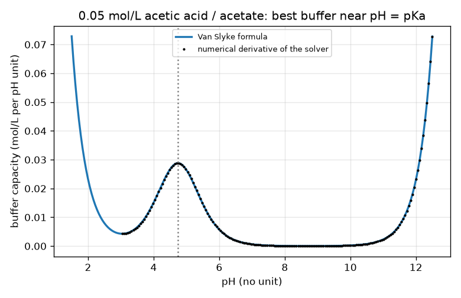
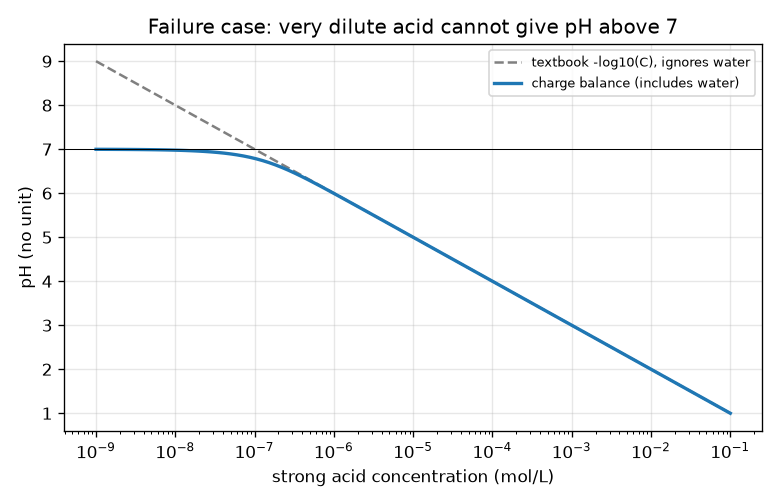
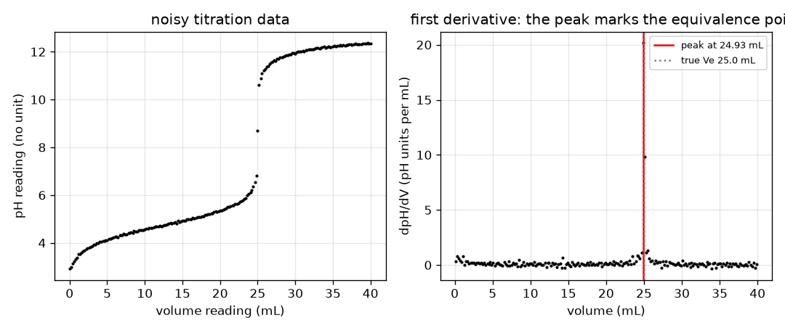
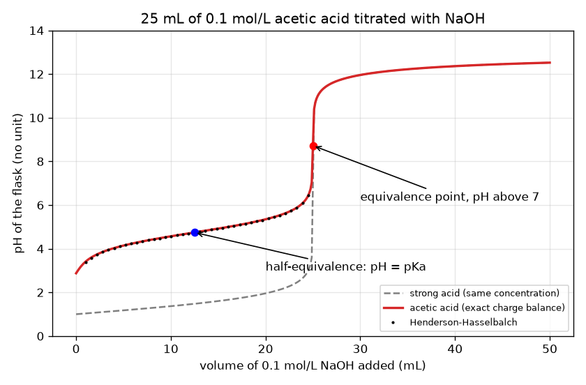

# Session 3: Weak acids: buffers, the numerical curve and the noisy endpoint

*Level 3 (simulation and validation) · about 90 minutes · openphtitration*

> This is a simplified educational model. It is not a validated design tool and must not be used for real structures, electrical installations, vehicles, industrial processes or medical decisions.

**Prerequisites**

- Session 2: pH, pOH, the mole balance and indicators.
- Session 1 and 2 code (`strong_ph`).
- Logarithms and the idea of solving f(x) = 0 by repeated halving.

**Learning objectives.** After this session you can:

- Use the acid dissociation constant Ka and the charge balance to compute a weak-acid titration curve.
- Write a bisection root finder and validate the curve against the strong-acid limit and the half-equivalence rule.
- Compare the Henderson-Hasselbalch relation with the exact solution and say where it fails.
- Find the equivalence point of a noisy curve from the maximum of the first derivative and find an unknown vinegar concentration.

## A. Real-world problem
Vinegar is acetic acid, a weak acid. Its titration curve differs from the strong-acid curve: it starts at a higher pH, has a long flat stretch (a buffer), and its equivalence point is above pH 7, so the indicator choice changes. Real burette readings are also noisy. How do we compute the whole curve numerically, test it against simple formulas, find the equivalence point from messy data and turn it into the strength of the vinegar? Simulation only: real vinegar titrations should still be done with a teacher.

## B. Concept and theory
A weak acid HA only partly splits: HA <-> H+ + A-, with Ka = [H+][A-]/[HA]. For acetic acid Ka is about 1.8e-5 (pKa = -log10 Ka = 4.74). If Ct is the total acid concentration and Na the sodium (from the base), charge neutrality says Na + [H+] = [OH-] + [A-], with [OH-] = Kw/[H+] and [A-] = Ct Ka/(Ka + [H+]). This is one equation in the unknown [H+]; its left side minus its right side rises steadily with pH, so it has exactly one root, which we find by bisection on the pH. Between the start and equivalence the flask holds both HA and A-, and the charge balance reduces to the Henderson-Hasselbalch relation pH = pKa + log10([A-]/[HA]); using moles, [A-]/[HA] = Cb Vb/(Ca Va - Cb Vb). At half-equivalence the two are equal and pH = pKa. At equivalence only A- is left and it makes the solution basic: [OH-] = sqrt(Kb C), Kb = Kw/Ka. The buffer capacity beta = dNa/dpH measures how much base the flask absorbs per pH unit; it is largest at pH = pKa. In a real run the volume reading and the pH reading are both noisy; the equivalence point is where dpH/dV is largest. Very dilute acids are a failure case: below about 1e-6 mol/L the water itself supplies H+ and the simple formula pH = -log10 C gives nonsense.

| Symbol | Meaning | Unit |
|---|---|---|
| Ka, pKa | acid dissociation constant and its -log10 | mol/L, no unit |
| Ct | total acid concentration in the flask, [HA] + [A-] | mol/L |
| Na | sodium concentration from the base | mol/L |
| h | hydrogen-ion concentration [H+] | mol/L |
| beta | buffer capacity, dNa/dpH | mol/L per pH unit |
| sigma_V, sigma_pH | standard deviations of volume and pH reading noise | mL, no unit |

**Assumptions**

- A single weak monoprotic acid and a strong base (NaOH), 25 C, ideal solutions (activities equal concentrations).
- Volumes add. The dissolved carbon dioxide in the water and the base is ignored.
- Reading noise is Gaussian, independent, with a known standard deviation.
- Ka for acetic acid is taken as 1.8e-5 (a standard value); the vinegar is 5 g of acetic acid per 100 mL, molar mass 60.05 g/mol.

$$ K_a=\frac{[\mathrm{H}^+][\mathrm{A}^-]}{[\mathrm{HA}]},\qquad \mathrm{p}K_a=-\log_{10}K_a $$

$$ N_a+h-\frac{K_w}{h}-\frac{C_tK_a}{K_a+h}=0\qquad(h=[\mathrm{H}^+],\ \text{solve for }h) $$

$$ \mathrm{pH}=\mathrm{p}K_a+\log_{10}\frac{C_bV_b}{C_aV_a-C_bV_b} $$

$$ \beta=\ln 10\left(h+\frac{K_w}{h}+\frac{C_tK_ah}{(K_a+h)^2}\right),\qquad \beta_{\max}=\frac{\ln 10}{4}C_t\ \text{at pH}=\mathrm{p}K_a $$

$$ V_e=\arg\max_V\frac{d\,\mathrm{pH}}{dV},\qquad C_{\mathrm{vinegar}}=\frac{C_bV_e}{V_a}\times\text{dilution factor} $$

## C. Visual explanation
The first figure shows 25 mL of 0.1 mol/L acetic acid titrated with 0.1 mol/L NaOH (solid red) beside the strong-acid curve (dashed grey). The weak acid starts at pH 2.88 instead of 1.00, rises through a flat buffer region, passes through pH = pKa = 4.74 at half-equivalence (blue dot) and reaches the equivalence point at pH 8.72, above 7. The black dots of the Henderson-Hasselbalch formula lie on the exact curve except at the very start. The second figure plots buffer capacity against pH: the formula and the numerical derivative of the solver coincide, with a maximum at pH = pKa. The third figure shows a noisy run and its derivative, whose peak sits at the equivalence volume. The fourth shows why 1e-8 mol/L of strong acid cannot have pH 8.

*Buffer capacity: the analytic formula and the numerical derivative of the solver agree, with a maximum at pH = pKa.*

*Failure case: the textbook formula gives pH 8 for 1e-8 mol/L of strong acid; including water gives the correct pH just below 7.*

*A noisy titration (left) and its first derivative (right): the peak marks the equivalence point.*

*Acetic acid versus a strong acid of equal concentration: higher start, buffer region, half-equivalence at pH = pKa, equivalence above 7.*

## D. Interactive simulation
Run the lesson (`python start.py 3`), then open the live app: [Session 3: weak acid titration](https://krunalpanchal1995.github.io/openphtitration/session-03/) (or `app.html` in this folder). Choose the acid pKa, the concentrations and the base volume. Watch the share of HA and A- in the flask, then switch to the curve to compare with the strong acid, and to the derivative view to see the peak. Move pKa and see how the equivalence point pH changes; lower both concentrations and see the jump shrink.

**Challenge.** Put the flask at half-equivalence for acetic acid (pKa 4.74): Vb within 0.3 mL of Ve/2, so that the pH equals the pKa.

## E. Worked example and experiment
**Problem.** 25 mL of 0.1 mol/L acetic acid (Ka = 1.8e-5) is titrated with 0.1 mol/L NaOH. Find the pH after 10 mL by Henderson-Hasselbalch, compare with the exact numerical value, and find the equivalence pH.

1. pKa = -log10(1.8e-5) = 4.745.
2. Moles: acid 0.1 x 25 = 2.5 mmol; base 0.1 x 10 = 1.0 mmol. After reaction n(A-) = 1.0 mmol and n(HA) = 2.5 - 1.0 = 1.5 mmol.
3. Henderson-Hasselbalch: pH = 4.745 + log10(1.0/1.5) = 4.745 - 0.176 = 4.569.
4. The bisection solver of the charge balance gives 4.569 as well (difference below 0.001).
5. Equivalence is at 25 mL: Ct = 2.5/50 = 0.05 mol/L of A-, Kb = 1e-14/1.8e-5 = 5.56e-10, [OH-] = sqrt(5.56e-10 x 0.05) = 5.27e-6 mol/L, pOH = 5.28, pH = 8.72. The solver gives 8.722.

**Answer.** After 10 mL the pH is 4.569 (formula and solver agree); the equivalence point is at 25 mL with pH 8.72, above 7.

**Experiment.** With supervision, a student titrates household vinegar (diluted) with a standard sodium hydroxide solution and a pH meter. The curve resembles this one: a start near pH 2.9 for a 0.1 mol/L solution, half-equivalence near 4.7 and an equivalence point between pH 8 and 9. Differences come from ionic strength (activities, not concentrations, set the pH), carbon dioxide absorbed by the base, temperature, a meter with a 0.02 to 0.05 pH uncertainty, and the actual Ka not being exactly 1.8e-5. Real vinegar also may differ from 5 percent. The model is idealised; the lab adds noise and bias.

## Real-world application and mini-project: Find the acid in a bottle of vinegar
Vinegar is about 5 g of acetic acid per 100 mL, which is 0.833 mol/L (molar mass 60.05 g/mol). A student dilutes 10.00 mL of vinegar to 100.00 mL, puts 25.00 mL of the dilution in a flask and titrates with 0.1000 mol/L NaOH, reading the burette every 0.2 mL. The readings have a volume noise of 0.03 mL and a pH noise of 0.02. Use `make_data` from Session 3 to generate the synthetic run (diluted concentration 0.0833 mol/L, pKa from `PKA_ACETIC`, volumes 0 to 35 mL), find the equivalence volume with `find_equivalence`, then use `vinegar_concentration` and `vinegar_percent` to report the vinegar strength.

**Deliverable:** A script that prints the true and the estimated equivalence volume, the vinegar concentration in mol/L and in g per 100 mL, the percentage error, and the scatter of the estimate over 100 runs with different noise seeds, and saves a two-panel figure (noisy data, first derivative with the peak marked).

**Success looks like:** The estimate is within 2 percent of 0.833 mol/L (the run in Session 3 gives 0.834 mol/L, 5.01 g per 100 mL) and the scatter over 100 runs is stated in mL and in percent of the concentration.

## F. Assessment and design challenge
**Question type A: Conceptual.** Why does a weak acid titration have a flat region around pH = pKa, and why is the equivalence point above 7 although acid and base have cancelled exactly?

Hint

Think about what species are in the flask in each region, and what A- does to water.

Step-by-step solution

Between the start and equivalence the flask holds both HA and A-. Adding a little base converts some HA to A-, which changes their ratio only slowly, so the pH, pKa + log10(ratio), changes slowly: a buffer. At equivalence only A- (the conjugate base) is left, and A- picks up H+ from water, leaving OH-, so the solution is basic and the pH is above 7. For a strong acid the leftover ions do not react with water, so the equivalence point is at exactly 7.

**Question type B: Numerical.** For the 0.1 mol/L acetic acid titration above, find the pH after 20 mL of base with Henderson-Hasselbalch. Then state the pH at 12.5 mL without calculating.

Hint

n(A-) = 2.0 mmol and n(HA) = 0.5 mmol. At 12.5 mL the two amounts are equal.

Step-by-step solution

pH = 4.745 + log10(2.0/0.5) = 4.745 + 0.602 = 5.347 (the solver gives 5.347). At 12.5 mL (half-equivalence) n(A-) = n(HA), so the log term is 0 and pH = pKa = 4.745 (the solver gives 4.745). Units: pH has no unit.

**Question type C: Graph and simulation interpretation.** In the Henderson-Hasselbalch comparison table, where does the formula fail and why? Which direction does it err?

Hint

Look at the 1 mL and 2.5 mL lines of the printed table and think about the assumption that [HA] and [A-] are given just by the moles.

Step-by-step solution

At 1 mL the formula gives 3.365 and the exact solution 3.408, a difference of about -0.044; at 2.5 mL the difference is -0.008, and from 5 mL on it is below 0.002. Near the start the acid itself supplies a noticeable amount of H+ (a pH of 2.9 is 1.3e-3 mol/L of H+, comparable to the 1 mL of base converted), so [A-] is larger than the base moles alone say. The formula underestimates the pH near the start and is accurate in the buffer region.

**Question type D: Design and optimisation challenge.** Design: a student must locate the equivalence point of a vinegar titration with a volume reading noise of 0.03 mL and pH noise of 0.02. Compare a 1.0 mL step with a 0.2 mL step and recommend a plan. What does a 0.5 percent target on the concentration require?

Hint

Use `make_data` and `find_equivalence` for 100 seeds with each step, and compare the standard deviation with 0.5 percent of Ve.

Step-by-step solution

With 0.2 mL steps the scatter of the endpoint is about 0.05 mL (0.2 percent of 25 mL); with 1.0 mL steps it is about 0.08 mL (0.3 percent). Both meet 0.5 percent here but the finer step is safer. Plan: coarse steps (1 to 2 mL) far from the end, then 0.1 to 0.2 mL steps within 2 mL of the expected jump, repeat 3 times and average. Trade-off: more readings cost time; a 0.5 percent target on 25 mL is 0.125 mL, so the scatter should be below about 0.04 mL for the average of the runs. Assumptions: Gaussian noise, no systematic error (such as a miscalibrated burette) which averaging cannot remove.

Score yourself with [RUBRIC.md](../../RUBRIC.md). Print the [activity sheet](activity_sheet.md) to work on paper.

## Common misconceptions
| Common misconception | What is actually true |
|---|---|
| The equivalence point of every titration is at pH 7. | Only for a strong acid with a strong base. A weak acid gives a basic solution at equivalence (8.72 for 0.1 mol/L acetic acid). |
| Henderson-Hasselbalch is exact. | It is an approximation that fails near the start and end of the curve, and for very dilute solutions. |
| A weak acid is the same as a dilute acid. | Weak means partly dissociated (small Ka); dilute means low concentration. A concentrated weak acid can still be strongly acidic. |
| Simple formulas work at any concentration. | Below about 1e-6 mol/L the water's own H+ matters: the textbook pH of 1e-8 mol/L HCl (8.00) is wrong, the real pH is 6.98. |
| More data points always remove the error. | They reduce random scatter but not a systematic error such as a miscalibrated burette or a wrong standard solution. |

## Glossary
- **Ka**: acid dissociation constant: how far an acid splits into H+ and its conjugate base
- **pKa**: minus the base-10 logarithm of Ka; the pH at which half the acid has split
- **buffer**: a solution that resists pH change because it holds a weak acid and its conjugate base
- **half-equivalence point**: the point at which half of the acid has been neutralised; pH = pKa
- **buffer capacity**: how much base the solution takes up per unit change of pH
- **bisection**: finding a root by repeatedly halving an interval in which the sign of the function changes
- **first derivative**: the slope of the curve; here dpH/dV

## Finish
1. Do the three coding tasks in [exercises.md](exercises.md).
2. Run `python start.py 3` again after your changes. It ends with the checkpoint; when it prints `PASS`, you are done. (Checkpoint only: `python start.py check 3`.)

Next: the [roadmap](../../promo/roadmap.md). Session 4 is yours to build.
